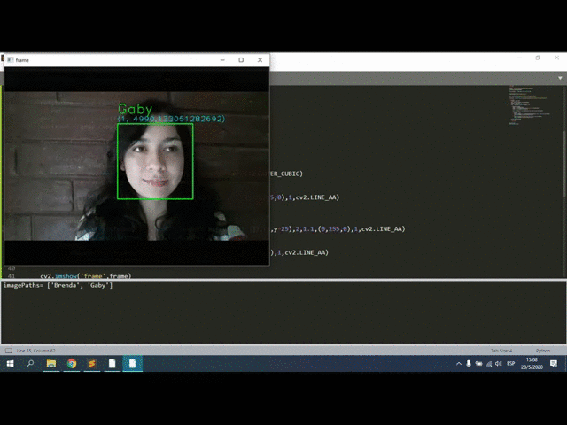
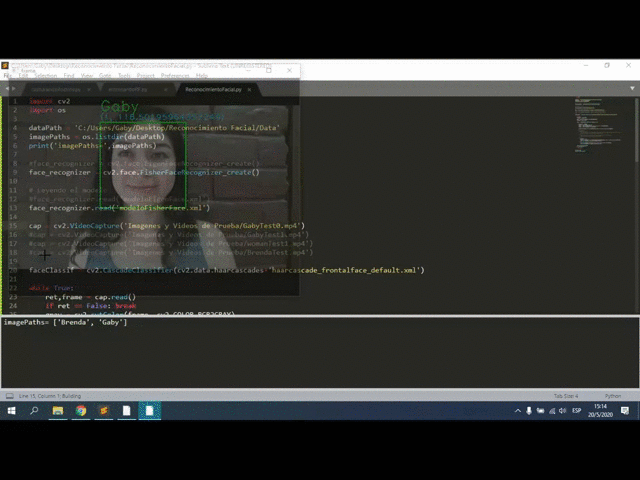
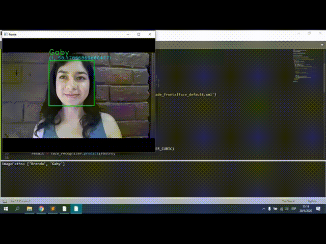

# 👩 Reconocimiento Facial + Control de Acceso con ESP32 👨 | Python - OpenCV

Sistema de control de acceso basado en **reconocimiento facial**. Una cámara Wi-Fi **A9 (V720)** transmite video a la PC, donde **OpenCV** detecta y reconoce rostros con el algoritmo **LBPH**. Cuando se reconoce a una persona autorizada, la PC envía una señal por puerto serial a un **ESP32**, que continúa el proceso de autorización (keypad y relé).

El proyecto parte del tutorial de Omes-va y fue adaptado para usar la cámara A9 y la integración con el ESP32:

- Blog: https://omes-va.com/reconocimiento-facial-python-opencv/
- Video: https://youtu.be/cZkpaL36fW4

---

## Cómo funciona

```
Cámara A9 (Wi-Fi AP) ──UDP/TCP──► PC (Python + OpenCV) ──Serial USB──► ESP32 ──► Keypad + Relé
                                   detecta + reconoce (LBPH)
```

1. **Captura**: se guardan fotos de rostro (150×150, escala de grises/color) de cada persona en `Data/<nombre>/`.
2. **Entrenamiento**: se entrena un modelo LBPH con todas las personas y se guarda en `modeloLBPHFace.xml`.
3. **Reconocimiento**: se detectan rostros con Haar Cascade, se comparan con el modelo y, si la confianza es menor al umbral, se envía `ROSTRO_OK` al ESP32.
4. El ESP32 responde `LISTO` cuando termina el ciclo y el sistema queda disponible para otro rostro.

## Estructura del proyecto

| Archivo / carpeta         | Descripción                                                                                                                                                               |
| ------------------------- | ------------------------------------------------------------------------------------------------------------------------------------------------------------------------- |
| `capturandoRostros.py`    | Captura rostros desde la cámara A9 y los guarda en `Data/<persona>/rostro_N.jpg`. Puede ejecutarse varias veces por persona: continúa la numeración existente.            |
| `entrenandoRF.py`         | Lee `Data/`, entrena el reconocedor LBPH y genera `modeloLBPHFace.xml`.                                                                                                   |
| `ReconocimientoFacial.py` | Programa principal: reconoce rostros en tiempo real y envía `ROSTRO_OK` al ESP32.                                                                                         |
| `app_web.py`              | **Interfaz web** (Flask): video en vivo, registro de personas, entrenamiento y reconocimiento desde el navegador. Reemplaza el uso manual de los tres scripts anteriores. |
| `reconocimiento.py`       | Utilidad de prueba: simula un reconocimiento escribiendo `ROSTRO` en el teclado, para verificar la comunicación con el ESP32 sin cámara.                                  |
| `modeloLBPHFace.xml`      | Modelo entrenado (se regenera con `entrenandoRF.py`).                                                                                                                     |
| `Data/`                   | Carpeta con una subcarpeta por persona registrada. Se crea al capturar.                                                                                                   |
| `a9-v720/`                | Librería de la cámara A9 (ver requisitos). Debe estar en la raíz del proyecto.                                                                                            |
| `requirements.txt`        | Dependencias de Python.                                                                                                                                                   |

## Requisitos

### Hardware

- Cámara Wi-Fi **A9 / V720 (Naxclow)**, usada en **modo AP** (ver sección _Cámara A9_).
- **ESP32** conectado por USB a la PC, con el firmware que reciba `ROSTRO_OK` y responda `LISTO` (el firmware no está incluido en este repositorio).
- Keypad y módulo de relé conectados al ESP32 (según tu montaje).
- PC con Python 3.8 o superior.

### Software

- Dependencias de Python (ver abajo).
- Repositorio de la cámara: [intx82/a9-v720](https://github.com/intx82/a9-v720). Los scripts lo importan desde `a9-v720/src` (módulos `netcl_tcp`, `v720_ap`, `cmd_udp` y `log`).

## Cámara A9 (modo AP)

Este proyecto usa la cámara en **modo AP (Access Point)**: la cámara crea su propia red Wi-Fi y la PC se conecta directamente a ella. No se necesita router, _fake server_ ni redirección DNS (eso solo aplica al modo STA de la librería de la cámara).

1. Enciende la cámara.
2. Conecta la PC a la red Wi-Fi de la cámara. Su nombre suele empezar con `Nax` (por ejemplo, `Nax_210000211234`).
3. La cámara asigna direcciones `192.168.169.x` (máscara `255.255.255.0`) y su IP por defecto es **`192.168.169.1`**, que es la usada en `CAMERA_IP`.

Notas importantes:

- La cámara **no tiene interfaz web**; sus ajustes de red solo se cambian desde la app móvil V720.
- Mientras la PC está conectada a la red de la cámara **no tendrá acceso a internet** (salvo que uses una segunda interfaz de red, como cable Ethernet). Los autores de la librería **no recomiendan conectar la cámara a internet**, ya que puede descargar actualizaciones desde servidores externos.
- La librería fue probada únicamente con la versión de cámara `202212011602` (app china V720, modo AP). Otras variantes o firmware más recientes (por ejemplo `20241120173` o superior) pueden presentar problemas de compatibilidad.
- Más detalles en [intx82/a9-v720](https://github.com/intx82/a9-v720).

## Instalación

```bash
# 1. Clonar este proyecto y entrar a la carpeta
cd Reconocimiento-Facial

# 2. Clonar la librería de la cámara dentro del proyecto
git clone https://github.com/intx82/a9-v720.git

# 3. (Opcional) Crear un entorno virtual
python -m venv venv
venv\Scripts\activate          # Windows
# source venv/bin/activate     # Linux / macOS

# 4. Instalar dependencias
pip install -r requirements.txt
```

| Librería                      | Uso                                                                                    |
| ----------------------------- | -------------------------------------------------------------------------------------- |
| `opencv-contrib-python` (4.x) | Detección de rostros y reconocedor LBPH (`cv2.face`). Se limita a la serie 4.x (`<5`). |
| `numpy`                       | Manejo de arreglos e imágenes.                                                         |
| `pyserial`                    | Comunicación serial con el ESP32.                                                      |
| `xmltodict`                   | Requerida por la librería de la cámara (`a9-v720`).                                    |
| `flask`                       | Interfaz web (`app_web.py`).                                                           |

> ℹ️ **No instales el `requirements.txt` de `a9-v720`.** Fija versiones antiguas (`numpy==1.24.4`, `opencv-python==4.8.0.76`, etc.) que no se instalan en Python recientes y que entran en conflicto con `opencv-contrib-python`. Para este proyecto la librería de la cámara solo necesita `xmltodict`, que ya está en nuestro `requirements.txt`. (`netifaces`, `Pillow` y `tqdm` los usan otros scripts de esa librería que aquí no se ejecutan.)

> ⚠️ Instala **`opencv-contrib-python`**, no `opencv-python`. El módulo `cv2.face` solo existe en la versión _contrib_, y tener ambos paquetes instalados causa conflictos.
>
> ⚠️ Usa **OpenCV 4.x** (`<5`). La versión 5.0 de `opencv-contrib-python` no incluye los archivos `haarcascade_*.xml` del detector de rostros, y los programas no pueden detectar caras con ella.

## Configuración

Ajusta estas constantes al inicio de los scripts según tu equipo:

| Constante                           | Archivo                                        | Valor por defecto        | Descripción                                              |
| ----------------------------------- | ---------------------------------------------- | ------------------------ | -------------------------------------------------------- |
| `CAMERA_IP` / `CAMERA_PORT`         | captura y reconocimiento                       | `192.168.169.1` / `6123` | Dirección de la cámara A9 en modo AP.                    |
| `ESP32_PORT`                        | `ReconocimientoFacial.py`, `reconocimiento.py` | `COM11`                  | Puerto serial del ESP32 (en Linux: `/dev/ttyUSB0`).      |
| `ESP32_BAUD`                        | `ReconocimientoFacial.py`                      | `115200`                 | Velocidad serial; debe coincidir con el firmware.        |
| `UMBRAL_RECONOCIMIENTO`             | `ReconocimientoFacial.py`                      | `70`                     | Umbral LBPH: **menor = más estricto**.                   |
| `CAPTURAS_NUEVAS`                   | `capturandoRostros.py`                         | `300`                    | Imágenes nuevas por ejecución.                           |
| `VIDEO_TIMEOUT` / `RECONNECT_DELAY` | captura y reconocimiento                       | `10` s / `2` s           | Reconexión automática si la cámara deja de enviar video. |

## Interfaz web

Si prefieres no usar la terminal, `app_web.py` ofrece todo el flujo desde el navegador:

```bash
python app_web.py
```

Luego abre **http://127.0.0.1:5000** (con la PC conectada al Wi-Fi de la cámara y el ESP32 por USB).

1. **Registrar persona**: escribe el nombre (sin tildes) y la cantidad de fotos, y pulsa _Iniciar captura_. Se guarda el rostro más grande que vea la cámara, con una barra de progreso.
2. **Entrenar modelo**: pulsa _Entrenar_ cada vez que agregues personas o fotos.
3. **Reconocimiento**: pulsa _Activar_. La casilla _Enviar ROSTRO_OK al ESP32_ permite probar sin activar el relé.

**Fuente de video (webcam de la PC para pruebas):** en la cabecera, el selector _Fuente_ permite alternar entre la **Cámara A9** y la **Webcam de la PC**. Si tienes varias webcams (o una virtual), aparece un campo con el índice (`0` = la primera). El cambio solo se permite cuando no hay una captura o reconocimiento en curso. También puedes arrancar directamente con la webcam:

```bash
python app_web.py --camara pc             # webcam de la PC
python app_web.py --camara pc --indice 1  # segunda webcam
```

Con la webcam no necesitas estar conectado al Wi-Fi de la cámara ni tener la carpeta `a9-v720/`: si la librería no está disponible, la web arranca igualmente y solo ofrece la webcam.

> 💡 **Usa la misma cámara para registrar y reconocer.** La A9 y la webcam tienen distinta resolución, iluminación y lente, y LBPH es sensible a eso: un modelo entrenado con fotos de la webcam rendirá peor con la A9 (y viceversa). Si pruebas con la webcam y luego pasas a la A9, vuelve a capturar y entrenar con la A9. Una forma limpia de separar ambos casos es borrar o mover `Data/` y `modeloLBPHFace.xml` al cambiar de cámara.

La cabecera muestra el estado de la cámara y del ESP32. Si tu ESP32 no está en `COM11`, define el puerto antes de ejecutar:

```bash
set ESP32_PORT=COM5            # Windows (cmd)
export ESP32_PORT=/dev/ttyUSB0 # Linux / macOS
```

> 🔒 **Seguridad:** el servidor escucha solo en `127.0.0.1` (esta PC). La página puede activar el ESP32, así que **no cambies `HOST` a `0.0.0.0`** sin añadir antes autenticación.
>
> Los scripts de línea de comandos siguen funcionando igual. No ejecutes la web y `ReconocimientoFacial.py` a la vez: ambos usan la cámara y el puerto serial.

## Uso (línea de comandos)

**1. Conectarse a la cámara.** Enciende la cámara A9 y conecta la PC a su red Wi-Fi (punto de acceso de la cámara).

**2. Capturar rostros de cada persona:**

```bash
python capturandoRostros.py
```

Escribe el nombre de la persona y mira a la cámara hasta completar las capturas. Se guardan en `Data/<nombre>/`. Pulsa `ESC` para salir antes. Para mejorar la precisión, captura con distintos ángulos e iluminación.

**3. Entrenar el modelo:**

```bash
python entrenandoRF.py
```

Genera `modeloLBPHFace.xml`. **Repite este paso cada vez que agregues o elimines personas o imágenes.**

**4. Ejecutar el reconocimiento:**

```bash
python ReconocimientoFacial.py
```

- Recuadro **verde**: persona reconocida (se muestra nombre y valor de confianza).
- Recuadro **rojo**: persona desconocida.
- Al reconocer a alguien se envía `ROSTRO_OK\n` al ESP32 **una sola vez**, hasta que el ESP32 responda `LISTO`.
- `ESC` o `Ctrl + C` para salir.

**(Opcional) Probar solo el ESP32:**

```bash
python reconocimiento.py
```

Escribe `ROSTRO` para simular un reconocimiento y enviar `ROSTRO_OK` al ESP32.

## Protocolo serial con el ESP32

| Dirección  | Mensaje       | Significado                                       |
| ---------- | ------------- | ------------------------------------------------- |
| PC → ESP32 | `ROSTRO_OK\n` | Se reconoció un rostro autorizado.                |
| ESP32 → PC | `LISTO`       | El ciclo terminó; se puede autorizar otro rostro. |

Configuración serial: `115200` baudios.

## Solución de problemas

- **`AttributeError: module 'cv2' has no attribute 'face'`**: tienes instalado `opencv-python`. Ejecuta `pip uninstall -y opencv-python opencv-contrib-python opencv-python-headless` y luego `pip install "opencv-contrib-python<5"`.
- **`Can't open file: ...cv2\data\haarcascade_frontalface_default.xml`**: tienes OpenCV 5.x, que no incluye los detectores de rostros. Reinstala la serie 4.x con los mismos dos comandos de arriba.
- **`Can't open file: ...modeloLBPHFace.xml` o imágenes que no se guardan/leen, con una ruta como `A├▒o 6`**: OpenCV en Windows no abre archivos cuyo ruta contenga `ñ` o tildes. `app_web.py` ya lo evita trabajando con rutas relativas. Los scripts de línea de comandos (`capturandoRostros.py`, `ReconocimientoFacial.py`, ...) usan rutas absolutas en algunos puntos: ejecútalos desde la carpeta del proyecto o mueve el proyecto a una ruta sin caracteres especiales (por ejemplo `C:\Proyectos\ReconocimientoFacial`).
- **`ModuleNotFoundError: No module named 'xmltodict'`**: ejecuta `pip install -r requirements.txt` (o `pip install xmltodict`).
- **"Webcam 0 no disponible" / "sin imagen"**: otro programa (Zoom, Teams, el navegador) puede estar usando la webcam; ciérralo. Si tienes varias cámaras, prueba otro índice en el selector. En Windows, revisa _Configuración → Privacidad → Cámara_ y permite el acceso a aplicaciones de escritorio.
- **`ModuleNotFoundError: netcl_tcp` / `v720_ap`**: falta clonar `a9-v720` dentro de la carpeta del proyecto (debe existir `a9-v720/src`).
- **No se pudo abrir `COM11`**: cierra el Monitor Serial del Arduino IDE (u otro programa que use el puerto) y verifica el número de puerto en el Administrador de dispositivos.
- **"Esperando imágenes de la cámara..."**: comprueba que la PC está conectada al Wi-Fi de la cámara (red `Nax_...`) y que puedes hacer `ping 192.168.169.1`. El programa reintenta la conexión automáticamente. Si nunca conecta, tu cámara puede tener un firmware no compatible con la librería.
- **Reconoce a la persona equivocada o falla con personas nuevas**: vuelve a ejecutar `entrenandoRF.py`. Las etiquetas se asignan por orden alfabético de las carpetas de `Data/`, por lo que el modelo debe reentrenarse cuando cambie esa lista.
- **Muchos falsos rechazos o falsos positivos**: ajusta `UMBRAL_RECONOCIMIENTO` y captura más imágenes con condiciones de luz similares a las de uso real.

## Referencia: resultados del tutorial original

Los siguientes GIF corresponden al tutorial original, que compara tres métodos. Esta versión del proyecto utiliza únicamente **LBPH**.

**EigenFaces**



**FisherFaces**



**LBPH**



## Créditos

- Proyecto base: [Omes-va](https://omes-va.com/reconocimiento-facial-python-opencv/).
- Comunicación con la cámara A9: [intx82/a9-v720](https://github.com/intx82/a9-v720).
